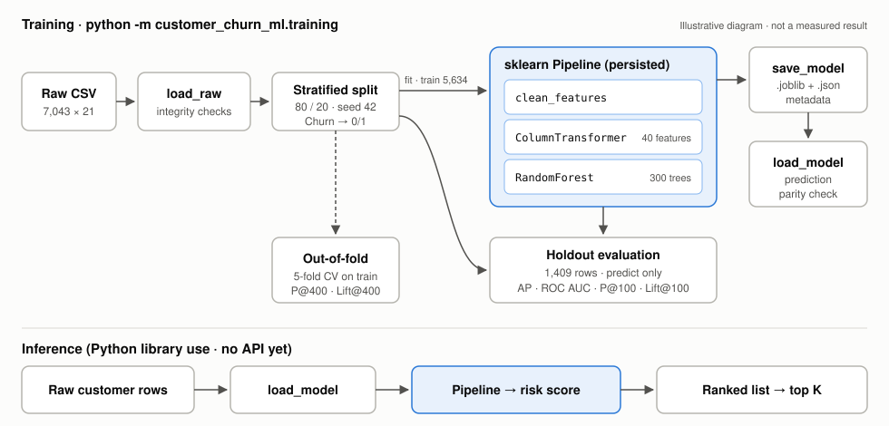
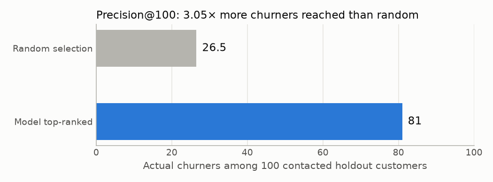
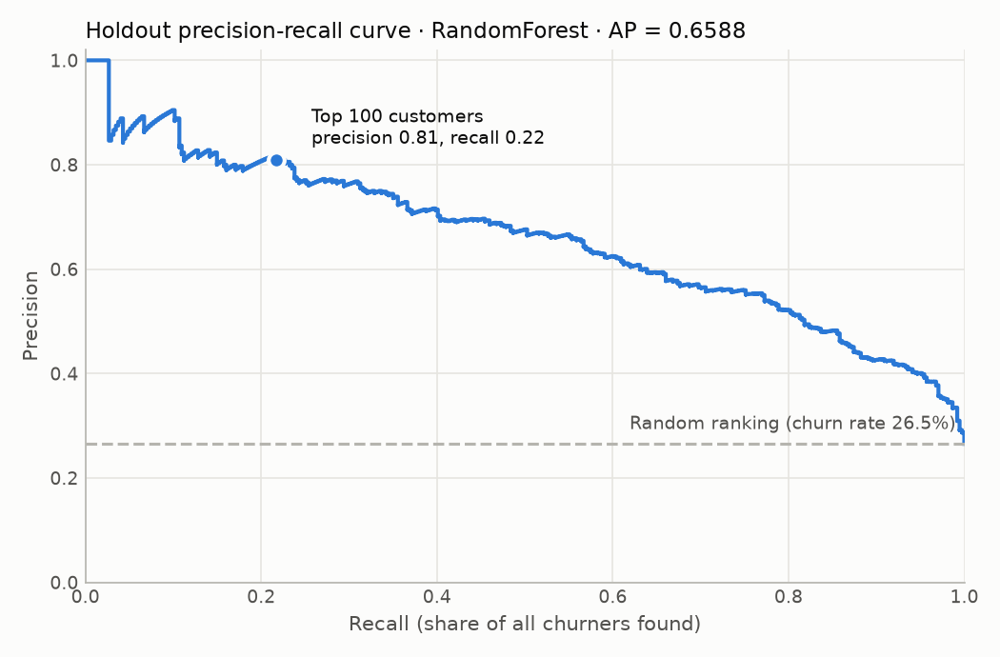
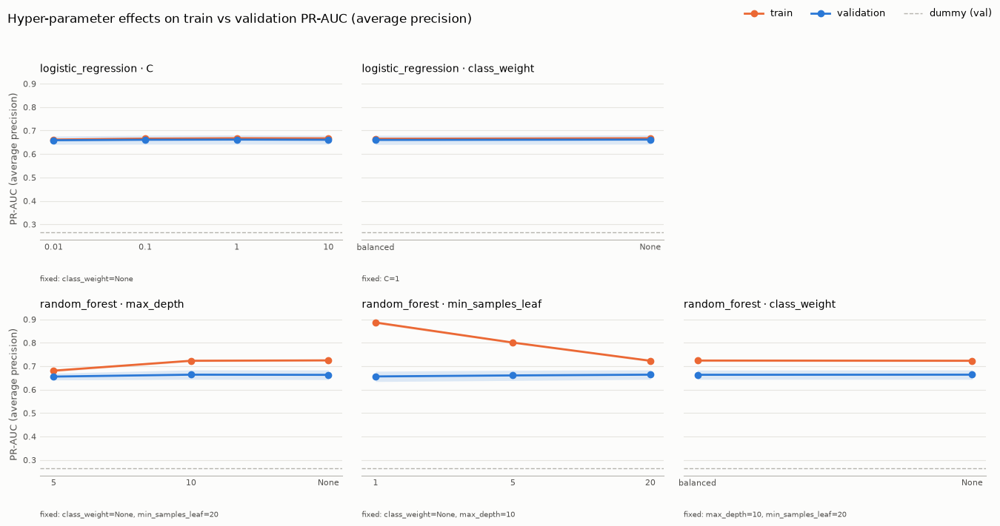

# Customer Churn Risk Ranking

[](https://www.python.org/)
[](https://scikit-learn.org/)
[](https://jupyter.org/)
[](https://docs.astral.sh/uv/)
[](tests/)

A reproducible machine learning system for customer churn risk ranking under limited outreach capacity.

[](https://colab.research.google.com/github/xuefeiyu2015/customer-churn-ml/blob/main/notebooks/quickstart.ipynb) &nbsp;📖 [Explore Analysis Notebook](notebooks/churn_analysis.ipynb)

## Project Overview

A reproducible ML training package that **ranks telecom customers by churn risk**, so a retention team that can only contact **500 of 7,043 customers** knows whom to call first. The workflow started as an exploratory notebook and was refactored into a tested Python package with a persisted end-to-end sklearn Pipeline.

## Key Results

| Holdout metric (1,409 customers) | Result |
|---|---|
| **Precision@100**: churners among the 100 highest-risk customers | **0.81** (vs. 0.265 at random) |
| **Lift@100** over random selection | **3.05×** |
| Average Precision (PR AUC) | 0.6588 |
| ROC AUC | 0.8441 |

<sub>Measured on a stratified 20% holdout of the IBM Telco dataset. This is a static benchmark: no deployment, and no claim about the causal effect of retention outreach (see [Limitations](#known-limitations)).</sub>


<sub>*Illustrative diagram.*</sub>

## Business problem

The retention team's capacity is ~7.1% of customers (500 / 7,043). What matters is **putting the most likely churners at the top of the list**, not classifying every customer correctly. Evaluation therefore focuses on ranking:

- **Precision@K**: the share of actual churners among the K highest-ranked customers ("of the people we call, how many were really at risk?").
- **Lift@K**: Precision@K divided by the base churn rate ("how much better than calling K people at random?").
- **Average Precision**: the primary model-selection metric, because churn is the minority class (26.5%). **ROC AUC** is reported as a secondary metric.

K keeps the 500 / 7,043 ratio for each evaluation set: **K = 100** on the 1,409-customer holdout and **K = 400** on the 5,634 out-of-fold training predictions. Using K = 500 on the holdout would overstate the budget.

## Results

<table>
<tr>
<td width="50%"></td>
<td width="50%"></td>
</tr>
<tr>
<td><sub><b>Measured, holdout.</b> 81 of the 100 top-ranked customers churned, against 26.5 expected from random selection.</sub></td>
<td><sub><b>Measured, holdout.</b> Precision-recall curve of the final model. The dot marks the top-100 operating point.</sub></td>
</tr>
</table>

**Selected model:** `RandomForestClassifier(n_estimators=300, max_depth=10, min_samples_leaf=20, class_weight=None, random_state=42, n_jobs=1)`, chosen in the [analysis notebook](notebooks/churn_analysis.ipynb) by 5-fold stratified grid search on the training split. The candidates were a dummy baseline, logistic regression and random forest.

| Training split only | Logistic regression | **Random forest** |
|---|---|---|
| CV AP, mean of 5 folds (± std) | 0.6615 ± 0.0195 | **0.6638 ± 0.0202** |
| OOF AP, pooled | 0.6585 | **0.6601** |
| OOF Precision@400 | 0.7825 | **0.8025** |
| OOF Lift@400 | 2.95× | **3.02×** |

- **CV AP vs. OOF AP:** *mean fold-level CV AP* averages five per-fold scores. *Pooled OOF AP* is one AP over all 5,634 out-of-fold predictions together. They measure slightly different things.
- **Why random forest:** the AP gap (~0.002) is far smaller than the fold-to-fold std (~0.02), so the random forest was preferred mainly for its higher Precision@400. Logistic regression remains a simpler, interpretable alternative.

<details>
<summary>Hyperparameter effects (from the analysis notebook, CV on the training split)</summary>



Increasing `min_samples_leaf` closes the random forest's train/validation gap. Logistic regression barely changes across `C` and `class_weight`.
</details>

No feature-importance chart is included: the analysis did not study feature attributions, and impurity-based importances over one-hot features would be easy to misread.

## Dataset

- **IBM Telco Customer Churn**, via [mlbookcamp-code](https://raw.githubusercontent.com/alexeygrigorev/mlbookcamp-code/master/chapter-03-churn-prediction/WA_Fn-UseC_-Telco-Customer-Churn.csv). The file is 7,043 rows × 21 columns: `customerID`, **19 input features** and the `Churn` target.
- **Split:** stratified 80/20 train/holdout split with `random_state=42` (5,634 / 1,409 customers).
- **Not redistributed:** the CSV is git-ignored, not committed. Download it from the public URL above and verify its SHA-256 (see [Getting started](#getting-started)). The mirror does not state license terms, so check the original IBM sample-data terms before reusing the data.
- **TotalCharges rule:** 11 customers have a blank `TotalCharges`. All have `tenure == 0`, so the value becomes 0. A blank value with `tenure > 0` raises an error rather than being imputed silently.

> **Static benchmark.** The dataset has no feature observation cutoff and no prediction horizon, so this is **not** a validated "who will churn in the next 30 days" system.

## Package architecture

| Module | Responsibility | Used in |
|---|---|---|
| `preprocessing.py` | `clean_features`: raw CSV-style rows → validated features (normalization, TotalCharges rule, Yes/No → 1/0; drops `customerID`/`Churn`). `prepare_target`: target → 0/1. `build_preprocessor`: one-hot + scaling `ColumnTransformer` (40 features). | Training and inference |
| `evaluation.py` | Pure metrics: `compute_k`, `precision_at_k`, `lift_at_k`, `positive_class_proba`, `compute_metrics`. Non-1D scores are rejected. | Training |
| `persistence.py` | `save_model`, `load_model` and `load_metadata`: a joblib artifact plus a JSON metadata sidecar, with overwrite protection. | Training and inference |
| `training.py` | Load → split → fit → evaluate → save → reload and verify. Also provides the command-line entry point. | Training |

**Why persist the whole Pipeline?** Cleaning, encoding, scaling and the model are saved as one sklearn `Pipeline`, so inference takes the same raw customer rows as training and applies identical transformations. This avoids training-serving skew.

## Getting started

**Colab:** use the badge at the top. The [quickstart notebook](notebooks/quickstart.ipynb) clones the repo, installs locked dependencies with uv, downloads and checksum-verifies the dataset, trains, shows the metrics, and scores raw customers. All model code runs from the package.

**Local** (Python 3.13, [uv](https://docs.astral.sh/uv/)):

```bash
uv sync --locked                    # runtime + dev dependencies
uv sync --locked --group notebook   # optional: Jupyter kernel + matplotlib
```

Put the dataset at `data/WA_Fn-UseC_-Telco-Customer-Churn.csv` (git-ignored). Expected SHA-256: `88be4b93fbe0cc83421af1c503794c97c342eca914c1576db7c276e61d61358a`.

### Train

```bash
uv run python -m customer_churn_ml.training
```

| Argument | Default | Description |
|---|---|---|
| `--data` | `data/WA_Fn-UseC_-Telco-Customer-Churn.csv` | Raw CSV path |
| `--model-out` | `models/churn_random_forest.joblib` | Model path (must end in `.joblib`); metadata is written next to it as `.json` |
| `--overwrite` | off | Replace existing artifacts (otherwise the run fails with `FileExistsError`) |
| `--no-oof` | off | Skip the 5-fold out-of-fold evaluation |

Default paths are resolved relative to the repository root. The command prints the holdout and OOF metrics as JSON. Training takes about 5 seconds.

### Predict from raw customer features

```python
import pandas as pd

from customer_churn_ml.evaluation import positive_class_proba
from customer_churn_ml.persistence import load_metadata, load_model

model = load_model("models/churn_random_forest.joblib")  # trusted files only

# Raw rows exactly as in the CSV; customerID is ignored, Churn is not needed.
customers = pd.read_csv("data/WA_Fn-UseC_-Telco-Customer-Churn.csv").drop(columns="Churn")

churn_risk = positive_class_proba(model, customers)  # 1D risk scores for ranking (uncalibrated)
top_500 = customers.assign(churn_risk=churn_risk).nlargest(500, "churn_risk")

print(load_metadata("models/churn_random_forest.joblib")["metadata"]["holdout_metrics"])
```

Invalid inputs raise `ValueError`: missing columns or values, non-numeric numbers, non-Yes/No binary values, and a blank `TotalCharges` with `tenure > 0`.

### Test and regenerate figures

```bash
uv run pytest -q                                                  # 41 tests
uv run --locked --group notebook python docs/make_figures.py      # measured figures in docs/figures/
```

## Engineering reliability

- **Leakage prevention:** scaler statistics and one-hot categories are learned inside the Pipeline from the training split only, and OOF evaluation refits the whole Pipeline per fold. A test with a shifted, holdout-only distribution checks that the fitted statistics exactly equal those of the training rows.
- **Training-serving consistency:** cleaning is the first Pipeline step (`FunctionTransformer(clean_features)`), so training and inference share one code path.
- **Deterministic training:** fixed seeds for the split, CV folds and forest, plus stable tie-breaking in Precision@K. Two runs produce identical predictions and metrics.
- **Serialization parity:** each training run reloads its saved artifact and fails if any prediction differs.
- **Metadata:** the `.json` sidecar records hyperparameters, split settings, the K rule, the 40 encoded feature names, holdout and OOF metrics, the dataset SHA-256 and row count, and library versions.
- **Notebook parity:** the package selects the same holdout rows as the analysis notebook and produces bit-identical holdout predictions.
- **41 automated tests:** evaluation 15, preprocessing 14, persistence 6, and training integration 6.

## Known limitations

- **Static data:** a single snapshot. Results do not establish prospective (future) prediction performance.
- **Scores are not calibrated probabilities:** risk scores are the RandomForest's `predict_proba` output and are used only to rank customers. Calibration was not evaluated, so a score of 0.83 does not mean an 83% chance of churning.
- **Ranking ≠ causal impact:** a high churn score does not mean outreach will retain the customer. Intervention effect, customer value and contact cost are not modeled.
- **Holdout was consulted during model selection:** the original notebook compared models on holdout results before selection was moved to out-of-fold evidence, so the holdout is not a completely untouched final test set.
- **Corrected Precision@K bug:** the original notebook reported holdout Precision@100 = 0.0 because an `(n, 1)` score array was ranked along the wrong axis. This was fixed in the refactor; metrics now reject non-1D input.
- **Unknown categories:** unseen values are one-hot encoded as all zeros. For single-indicator columns (`drop="if_binary"`, e.g. `gender`) they are indistinguishable from the dropped reference category.
- **Not jointly atomic:** the model and metadata files are each written atomically, but not together. A crash between the two writes can leave a model without metadata.
- **Trusted artifacts only:** joblib files are pickles and can execute code when loaded.

## Next steps (not implemented yet)

- FastAPI inference service around `load_model` + `positive_class_proba`
- Request/response validation (e.g. Pydantic schemas for the raw feature columns)
- API integration tests
- Docker containerization

## Repository layout

```
├── data/                           # raw CSV (git-ignored)
├── docs/
│   ├── figures/                    # architecture diagram + measured result charts
│   └── make_figures.py             # regenerates the measured figures
├── models/                         # trained artifacts (*.joblib git-ignored)
├── notebooks/
│   ├── quickstart.ipynb            # Colab-ready end-to-end demo using the package
│   └── churn_analysis.ipynb        # EDA and model-selection record
├── src/customer_churn_ml/          # preprocessing, evaluation, persistence, training
└── tests/                          # 41 pytest tests
```
